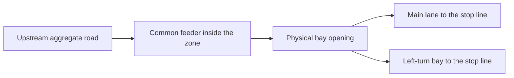

# Concrete traffic model: lane allocation, bay access, storage and service

**Current consolidated model, after question closure:** actual-admission balancing, unassigned movement-priority residuals and physical lane access are fully transcribed in the [current specification](../../reporting/research_readiness/urban_methodology_specification.pdf). The processing/access distinction is resolved; no question remains from this set. Earlier waiting-target prototypes and dated open statuses below are historical.

**Historical feedback-10 answer status before consolidation:** new unadmitted mass stays unassigned and only actual lane admission binds. The allocator may inspect later movements while retaining priority within a blocked movement. How that processing maps to physical common-feeder access remains open. Constant average receiving A is retained; old-target rationing is withdrawn. This is an answer/status update, not a new coupled-model derivation.

[Feedback 10: answers and resolved/open status](../../reporting/research_readiness/urban_feedback10_response.md)

**Current reading route, 27 October:** the [joined proposal](unified_methodology_draft.md) now supplies exact proposed laws. Its fork assignment location, waiting-intent construction and permission subfamily are explicit proposals, not automatic approval of this discussion's earlier prototypes. The broad question batch below remains closed.

**Question batch closed, 26 October 2026.** The user accepts the amended conclusions and authorizes the next set. The discussion below retains the selected traffic meanings; closure does not claim complete joined equations or numerical validation.

[First unified technical draft](unified_methodology_draft.md)

[Current-ready-head receiving timing agreed on 27 October](receiving_priority_timing.md)

[Feedback 9 answer: use known capability in allocation](../../reporting/research_readiness/urban_feedback9_response.md)

[History refinement deferred; timestep scope retained](service_history_consistency.md)

[Closed policy discussion: aggregate comparison models B1 and B2](aggregate_rival_questions.md)

A turner has a lane target, but through traffic prevents it from reaching the bay opening. More through service can remove the obstruction; more left service may initially do nothing. To predict that response, the model must locate the opening, distinguish a target from physical occupancy, and say how an ordered lane uses its average service. The agreed principles do not yet determine those laws.

26 October 2026, incorporating the feedback-7 amendment and subsequent closure. The user withdraws frozen queues and selects source-order packets with per-packet continuous balancing; later packets see earlier assignments. Internal geometry, elapsed-rate service, green-weighted/equal-within-leg receiving with caps/reuse, commitments, source/realized-lane order and route identity stand. No implementation or experiment is authorized by this closure.

[Current amendment response and qualifications](../../reporting/research_readiness/urban_feedback7_amendment_response.md)

[Feedback 7 response](../../reporting/research_readiness/urban_feedback7_response.md)

[Historical explanation of the now-resolved frozen-queue question](queue_snapshot_choice.md)

[Feedback 6 response and collected clarifications](../../reporting/research_readiness/urban_feedback6_response.md)

[Closure and current decisions](review_decisions.md)

## Where does a turner reach the bay opening?

Suppose the common feeder reaches an opening into a through lane and a left bay. Its eligible order is through mass 0.4 followed by left mass 0.6. The bay can receive 1.0, while the through lane can receive only 0.2. The first 0.2 of through mass can enter. The remaining through mass still occupies the common approach to the opening, so the left mass cannot use the vacant bay yet. Logical allocation of both targets can already be complete. This is physical obstruction, not a refusal to split a large packet.

| Through receiving allowance | Bay allowance | Physical admission from that feeder, if its other bounds permit |
|---|---|---|
| 0 | 1.0 | Neither block enters |
| 0.2 | 1.0 | Through 0.2; the remaining through block still obstructs left entry |
| At least 0.4 | At least 0.6 | Through 0.4 and left 0.6 can pass the opening in order |

These allowances are illustrative continuous masses, not calibrated settings or an executed case. The same rule must not impose one global FIFO order on genuinely independent feeder lanes.

**Keep the opening inside the detailed zone — `G.internal`.** Represent a physical common-feeder section inside the zone, followed by the parallel through section and bay. Their actual lengths, capacities and travel histories locate the opening. Exact ordered mass approaches that boundary; a blocked front cannot be bypassed on a single common feeder. After the branch, the two lanes have separate ordered states and can discharge independently. This preserves the accepted V2/V3 description of an opening inside the interaction zone, but requires explicit local-section ownership and propagation.

**Former alternative, rejected for this model — `G.mouth`.** Starting the detailed zone at the physical opening would retain the feeder upstream and change the accepted interior-opening description. Feedback 6 rejects this direction: the near-intersection geometry belongs inside the zone. It remains recorded for traceability.

**`G.internal` is selected**, making the accepted interior opening explicit. A model can use existing first-order cumulative-count physics on its physical local sections, while keeping each lane's rank-based order/grid. Applying that physics locally remains a proposed composition, not functionality already supplied by M2. The mass-rank grid does not itself locate an opening in meters.

A queue extending through the opening into the single common feeder can obstruct entry toward both branches. A full branch does not automatically close every other path: the model must establish occupation/access on that common path. Reaching the mouth and protruding into an obstructing upstream queue are distinct conditions. Independent physical feeders do not acquire one global FIFO. No phase-order rule is required at the opening; spatial storage and causal congestion propagation are required.

A valid commitment stays fixed under either option. Under `G.internal`, a bay-bound block may physically occupy the common feeder before entering the bay. Its target and current physical section therefore need distinct meanings. Its pending label does not add another physical queue or TST stock. This extends the concrete ownership description beyond the earlier simplest upstream-only waiting view; it does not allow retargeting or free physical lane changes.

For the internal prototype, I propose making a new assignment when a block first becomes physically eligible to enter the detailed feeder, even if it must wait for room. Earlier valid targets are reused; waiting alone does not trigger another choice. Internal section crossings keep the global route reference/position, while changing the local physical section. For a fair geometry comparison, the mouth-aligned alternative must retain the same physical choice location or explicitly report a changed decision location/information; moving the refinement boundary does not establish behavioral equivalence by itself.

There is also a useful limit on the allocation question: **two lanes do not necessarily provide two legal choices**. If left traffic may use only the bay and through traffic only the other lane, each movement's target is forced. Responsive allocation remains the general policy, but has no choice to make in that special case. The accepted suite names the layouts, while the concrete permission matrix still needs stating. This packet does not silently add left turns to a through-only lane to activate an allocator.

**Feedback 9 correction for new allocation:** use currently known sending, receiving and accessibility as constraints in the allocation itself. Queue preference remains queue-based; physical feasibility is not deferred to an independent post-hoc correction of newly invented targets. The earlier numerical water-filling examples are restricted/nonbinding or conditional prior-commitment cases, not a full constrained rule. Existing valid waiting commitments are preserved. The precise coupled transcription is later work, not opened by this answer-only response.

## What does “the less congested lane” mean?

**`L.queue` now processes packets sequentially in source order.** The amendment explicitly withdraws the timestep-start freeze. For each packet, use the current queue-load estimate, balance its continuous mass over legal alternatives, then update the estimate with those assigned amounts before processing the next packet. Earlier committed waiting loads do not vanish merely because actual entry is delayed. These are logical estimates; physical storage is still consumed only at actual admission, with mass counted once.

For matched lane alternatives, fill shorter queue levels first and share further mass among the tied shortest lanes. From loads 0.2/0, a unit gives intended additions 0.4/0.6; only 0.1 gives additions 0/0.1 and cannot make both queues equal without moving old traffic. Existing commitments are not reassigned to force equality. Each packet's lane amounts can be calculated together; heterogeneous packets need no global simultaneous allocation solver. The previous frozen-background/full-cost choice is resolved, and service-plan knowledge remains excluded.

**Unselected service-aware alternative — `L.work`.** Estimate clearing time from current queued/committed traffic and known average movement rates, plus remaining travel time. A small queue with poor service can be less attractive than a larger well-served queue. Feedback 6 sets this aside because the current driver-information model does not supply service-plan knowledge. Its zero-service extension remains unnecessary to the selected direction; no epsilon or hidden fallback is introduced.

For illustration, suppose left traffic is legally allowed to choose an exclusive bay or a shared lane. The bay has two left equivalents ahead; the shared lane has one through equivalent. With comparable geometry, queue pressure initially favors the shorter shared queue. If left service is generous and through service scarce, queued work can instead favor the bay. This example requires those shared-lane permissions; it is not a change to the primary suite's permissions by implication.

Physical moving traffic still propagates and counts in TST. At a fixed state the queue-based allocator has no direct service-plan input, but it responds to queues produced by earlier control. Identical adjacent packets with the same relevant route state/legal alternatives may be grouped where exact progressive balancing is preserved; heterogeneous source order must not be erased. The earlier normalized cost formula remains a historical prototype rather than automatic approval of all its coefficients. A unique legal target still forces assignment.

## Does a homogeneous split need an artificial target order?

**No: split each homogeneous packet across its lanes, then process the next source packet.** The retained alias `A.joint` refers to one packet's lane amounts, not a global solve over heterogeneous packets. Each lane appends children in parent source order, naturally preserving its movement sequence. The earlier `A.pieces`/`A.curve` vote remains withdrawn. Current movement can organize the allocation and grid; route-table identity/position must remain in the ordered ledger and emitted packets, and mixed grid totals alone cannot reconstruct exact order at discharge.

With matched lane queue measures, the bay at 0.2, the other lane empty and one new unit give intended additions 0.4/0.6. Storage 1.0 each permits both lanes to finish at 0.6. Storage 0.5 each permits actual additions 0.3/0.5, filling both and leaving 0.2 upstream, if other bounds allow. This static illustration assumes sufficient feeder sending, available receiving, no tighter entry-rate/travel limit and no intervening blocker. Storage alone does not ensure those conditions and is not a per-second service rate. The amendment restores the progressive balancing interpretation.

If the 0.4/0.6 target totals were already fixed, their residuals are 0.1/0.1, both on the common feeder. Feedback 7 confirms this interpretation: physical upstream location does not make the entire residual target the other lane. Existing commitments stay fixed.

Homogeneity preserves persistent route state, current movement, legal alternatives and applicable prior commitments. Joint splitting does not let a later different source block pass an obstructed earlier block, relax realized-lane order, or reassign an already committed target. Pending records are views of physical upstream/feeder mass. A conservative parent block with fixed target shares and single-target lane-admission children is a possible transcription, not an approved replacement of M2's ingress interface. No additional physical buffer is implied.

Perfect queue-load balance has a multiplied-capacity aggregate limit only under corresponding symmetric lane states, permissions, service, propagation/storage and access. Equal totals alone do not remove independent FIFO heads, bay geometry or residual storage. The per-lane model therefore remains. Continuous balancing is piecewise differentiable on fixed active sets; constraint changes can create kinks. Neither this observation nor a finite gradient establishes downstream usefulness. Imperfect desired-lane preferences are deferred.

Conservation, partial-transfer/residual accounting and ingress/timing compatibility remain construction obligations, not an additional user decision justified by this example. The earlier broad partial-admission question is withdrawn. If construction reveals a concrete conflicting traffic case, bring back that case and the smallest affected choice. The strict single-target prefix applies when such order really exists; it cannot be imposed on a new homogeneous split by arbitrary concatenation. The original through-before-left obstruction example remains unchanged.

## How does a mixed lane use average service?

Movement capacity limits do not determine what happens when a front left block clears and exposes through traffic during the same interval. Both following laws retain the exact prefix and allow partial mass. Neither adds an on/off phase clock.

**Run an ordered server at each head's average rate — `S.elapsed`.** The front movement consumes elapsed time at its allocated average rate. When it clears, the next movement can use its own average rate during the time remaining. A zero-rate or physically blocked head stops that lane. This gives a direct causal meaning to continuous average service, including the time spent waiting for its effective opportunities.

**Spend step-wide protected-group service budgets — `S.budget`.** Each lane receives the group's allocated amount of physical saturation-service time for the interval. Process the exact front at saturation rate while its group has budget and physical time remains. A later movement can spend its remaining group budget once exposed. This treats the effective fractions as spendable interval reservations; it does not require the head to have been exposed throughout the interval. Such opportunities need not correspond to one executable phase schedule, consistent with the task's current claim level.

Consider one already-ready shared lane, saturation one mass unit per second, and a one-second illustrative interval. All four group fractions are 0.25. Its order is left 0.05 followed by through 0.8; receiving is nonbinding.

| Candidate | Left served | Through served | Why |
|---|---|---|---|
| `S.elapsed` | 0.05 | 0.20 | Left uses 0.20 seconds at its average rate; through uses the remaining 0.80 seconds at its average rate |
| `S.budget` | 0.05 | 0.25 | Left uses only part of its group budget; through can then spend its full 0.25-second group budget |

Both respect individual movement bounds and exact order, yet give different departures and local control responses. The example is hand arithmetic, not an experiment or a selected timestep. It demonstrates why “average service” alone did not close this concrete question.

**`S.elapsed` is selected**, matching the desired elapsed-rate meaning. `S.budget` is an unselected alternative; it can also enforce physical constraints, so omitting them is not an intrinsic property of every budget law. Neither is established as more accurate or useful by this reasoning. Arrival eligibility, per-lane saturation units and receiving remain part of the selected law; copying a whole movement/link capacity to every lane would multiply physical capacity.

## Can another reachable head use unspent downstream room?

Several lanes can request the same downstream receiving allowance. Exact FIFO within each lane does not determine how that shared room is divided. Nor does the order in which software visits lanes establish a physical priority.

**Reserve grants for the interval — `R.reserve`.** First make fixed receiving grants using the declared movement demands and priority convention, then apply ordered service within those grants. Unused reservations remain unused for that interval. This is a concrete resource-reservation philosophy, but can waste room when an ordered obstruction prevents use of a grant. The existing neutral quota-replay pattern does not establish that it is the right shared-lane law.

**Reuse receiving room among reachable heads — `R.reuse`.** Let feasible current prefixes and fixed physical priorities determine who can use the common room. When one head cannot use a share, another eligible head may use it within its own service limits. This avoids making unused reservations into an extra obstruction. The exact joint allocation rule and its priority reconciliation are still a modeling direction to formulate, not a finished node model in this packet.

For example, suppose two lanes are each granted 0.5 of one unit of downstream room. The first can send only 0.2 before its next block needs a closed different exit. The second could use 0.8. Frozen grants permit only 0.2 plus 0.5; a feasible joint allocation can permit 0.2 plus 0.8. This is conditional on their own service bounds and the declared priority rule. Reusing physical receiving room does **not** transfer unused left-turn service to through traffic.

**`R.reuse` now has the sharing principle selected in feedback 7:** give inbound legs shares proportional to the green for their movement into the common exit, then divide each leg's grant equally among its eligible lanes. Cap by feasible demand and reuse unused shares within the leg, then among other legs according to green weights. Thus green weights 3:2 with one receiving unit give leg shares 0.6/0.4; two eligible lanes on the first leg get 0.3 each if bounds permit. Copying the full leg weight to each lane would incorrectly reward extra lanes.

This is a simultaneous quantity rule, not phase or software traversal precedence. Zero-green movements have zero service; reuse cannot bypass that. Green remains in the average service bound and is not multiplied into an already allocated discharge again. The relevant green is movement-specific for this exit, not an unspecified sum of all phases serving a leg. A full joined model has not been opened by the feedback-7 response. M0's restricted no-redistribution green quotas are not this new receiving law. No simulator behavior is changed by the review.

**Later decision, 27 October:** the user selects sharing among currently ready heads in the first draft's two-lane comparison, closing the narrow time basis under G2/C3. A new head joins the present competition without compensation for earlier discharge. Both alternatives already need order-aware service; the selected one lets order directly shape the result. The [separate note](receiving_priority_timing.md) records the choice and rationale. The updated draft states capped sharing and its conditional local derivative; full physical history/admission composition remains. Weights, caps, reuse, exact order and elapsed-rate service stand.

For all candidates, preserve causal sending/receiving and travel eligibility. A departure changes boundary histories; its effect on upstream room follows the selected physical propagation. Do not simply add that departure to immediate entry room. Newly admitted traffic does not also receive service from the same physical section in the same update. Pending assignment is not physical admission. These carried-forward meanings constrain the concrete equations rather than create another broad principles vote.

## The choices collected for your written review

| Concrete question | Position after feedback 6 | What is settled and what remains |
|---|---|---|
| Where is bay access represented? | `G.internal` selected; `G.mouth` rejected | Physical common-path obstruction, with causal propagation and compatible section timing still to formulate |
| What determines desired lane shares where alternatives exist? | Source-order packets, per-packet continuous queue balancing and updates visible to later packets | Amendment explicitly withdraws the freeze; no remaining choice in this batch. Equality is as feasible without moving old mass. |
| Does a homogeneous split create a target sequence? | `A.joint`; residual interpretation confirmed | No mandatory target-order or bookkeeping vote; conservative transcription remains construction work |
| What does the shared lane's average service mean? | `S.elapsed` selected | Ordered elapsed-rate service; full receiving/eligibility coupling still needed |
| How is common downstream room shared? | Green-weighted across currently competing legs, equal among their ready lanes, with feasible caps and reuse | Sharing principle settled; current-ready-head time basis subsequently selected on 27 October |

The traffic-choice batch, comparison policy and current-ready-head receiving timing remain closed. Feedback 9 clarifies the new-allocation dependency: known physical feasibility belongs inside allocation. The earlier shared-sending A/B comparison is not a mandatory gate for that normal process, and neither old conditional law is approved as the general model. Prior valid commitments remain constraints; event histories stay deferred. The generic bookkeeping question remains withdrawn. Exact coupled transcription is later work, with no next-step task or new question opened in this reply.

[Read the amendment agreement](../../reporting/research_readiness/urban_feedback7_amendment_response.md)

[Candidate definitions, hand comparisons and local sensitivities — PDF](../../reporting/research_readiness/urban_coupled_lane_model_candidates.pdf)

[Sources, inherited assumptions and proposed amendments](../../extraction/research_readiness/urban_coupled_model_source_and_assumption_notes.md)

[Living question inventory and named subvariants](../../extraction/research_readiness/urban_open_question_register.md)

[Work record and checks](../../reporting/research_readiness/urban_coupled_model_opening_work_report.md)
