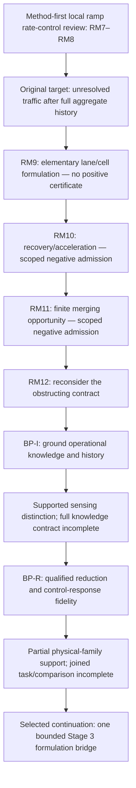

# Where BP-R sits in the ramp-review tree

Date: 2026-10-06. Semantic clarification of the completed BP-R result and the
user's selection of BPR-G3 candidate A. No new source search, traffic law,
observation restriction, derivative method or experiment is introduced.
[Disposition and continuation approval](user_closure_and_stage3_selection.md)
records the current boundary.

## The principal change: unknown traffic versus an adequate representation

The earlier question was: **after using every admitted aggregate observation
and its history, can traffic detail still remain unresolved, and can that detail
change a useful ramp-meter decision?** Lane differences at one instant were not
enough. The difference had to survive everything the controller legitimately
knew, then matter to the same available rates and complete system time.

BP-R asks: **for a declared traffic scenario, how much detail must an independently
evolving model retain to preserve the response to changing the metering rate?**
The detailed starting traffic may be known and public. The problem is whether
compressing it into a particular state and update law loses consequential
dynamics. A compact model with appropriate memory or extra continuous statistics
may preserve them; it is a valid outcome if it does.

These questions are related, but not equivalent. Knowing a traffic condition
and having a model that represents its future consequences are different things.
Earlier, reconstructing the relevant state could defeat the proposed hidden-
information witness. Now, reconstruction does not automatically certify a chosen
reduction's prediction. Conversely, defeating one poor reduction does not prove
that fine identity is necessary or that the original information is unknowable.

## What remains the same, and what is being reformulated

| Aspect | Before RM12 backtracking | BP-R and the selected formulation continuation |
|---|---|---|
| Traffic/control setting | One local controlled ramp merging into a mainline | Retained; no automatic extra ramp or lane |
| Decision | Common bounded open-loop rate schedules/perturbations | Retained; no change to gap-targeted releases, PID or MPC |
| Outcome | Complete all-stream total system time through clearance | Retained; count road, ramp and entrance waiting |
| Primary distinction | Different traffic compatible with the full admitted aggregate history | Different adequacy of named independent model reductions for a shared physical scenario |
| Initialization | Same admissible information/history; known complete state plus exact deterministic laws fixes the future | Common declared physical initialization/forcing, explicit projections and initial memory for each reduction; no private fine-controller truth |
| Physical mechanism | RM9 adopted an elementary first-order lane/cell mechanism; RM10 examined recovery/acceleration families; RM11 examined finite merging opportunity | A previously examined entry/acceleration-dependent discharge family is retained as a provisional lead; a coherent local task law still needs qualification |
| Aggregate competitor | Allowed all admitted aggregate history and credible reconstruction/compact state | Strong independently evolving spatial, memory, moment and lane-aggregate closures remain competitors; no repeated reference-state corrections |
| Positive result | A lawful full-history residual affecting common useful rate actions, followed by a credible gradient study | A control-relevant loss of response in a qualified reduction, with justification for a more adequate retained state; gradient correctness/usefulness remain separate |
| Valid sufficient result | Aggregate information/state suffices within stated premises | A compact model preserves the relevant response without finer identity |

The shared setting is therefore largely continuous with the earlier line. The
largest approved change is the **research claim and comparison contract**. The
next formulation is not an approved new traffic equation or a completed task.

## A concrete way to distinguish the questions

For illustration, suppose a small group has recently entered from the ramp at
low speed and is still accelerating. Its speed, position and remaining recovery
could matter to near-term traffic disturbances. This is an explanatory example,
not a new matched-history witness or a demonstrated BP-R positive case.

The earlier review first had to ask whether that condition remained unresolved
after all aggregate mass/flow/speed/ramp observations and history. If those records
or the known complete initialization determined the relevant condition, this
example could not establish irreducibly hidden information.

The BP-R question can start with that same condition openly specified. One model
might retain the group dynamics; another might retain road density and congestion
memory; a third might also retain an entry-speed or recovery statistic. Under the
same rate change, do they predict the resulting exit-time response adequately?
Does any discrepancy alter a useful decision after counting ramp holding costs?
If a compact statistic removes the relevant discrepancy, the conclusion favors
that statistic rather than group identities.

Fairness requires declared projections, parameter fitting, memory and estimator
access. The richer controller does not get secret actual traffic. A compact model
cannot receive the fine model's future trajectories as inputs, or silently run
the fine dynamics elsewhere and still be called a compact independent closure.
The comparison tests a representation, not unequal knowledge.

## Two comparisons must not be conflated

**Compared with RM9's elementary formulation:** a source-supported dynamic
disturbance family could add speed/recovery-dependent service behavior beyond
the adopted first-order occupancy/receiving/lateral mechanism. After RM9's
separate-resource amendment, forward sending was recomputed after lateral arrivals;
there was no automatically debited lateral service budget or newly added
disruption penalty. The new family would therefore need an explicit physical
transfer, not merely a renamed version of that law.

**Compared with RM10/RM11 immediately before backtracking:** acceleration/recovery
is already an examined physical lead. BP-R has not discovered that mechanism
anew. RM10/RM11 could not join it, or finite geometry, to the strong history/action
certificate. BP-R revisits model adequacy under the changed claim. The previous
negative admission remains valid for its original target; the same source family
can be worth considering for a different target.

Finite geometry remains a source-dependent task property, not an automatic
combination of all earlier alternatives. Selecting the BP-R continuation does
not adopt every recovery/geometry assumption discussed previously.

## Position of the review lines

This records the actual review chronology. BP-I and BP-R change different
contracts: BP-I sought a genuine information domain for the original question;
BP-R explicitly changes the comparison claim. The original information question
remains unresolved positively and its missing evidence is preserved. The active
continuation studies representation adequacy. The earlier BP-M physical-task and
BP-U release-timing options remain alternatives requiring their own selection;
they are not automatically appended stages.

The repeated letter A has different local meanings: **RM10 Option A** was the
recovery review; **BPR-G3 candidate A** is the selected bounded formulation
continuation. The latter is not approval of all equations in the former.

## What continuation would establish

The next attempt must first bind one conservative, source-grounded local task
whose rate interventions can matter to complete system time. It must then state
the strong independent reductions and the response/decision criterion. Only a
surviving task justifies the later gradient/readiness review. A compact sufficient
model, a failed source-to-task bridge or an action-irrelevant discrepancy can each
close the attempt without manufacturing finer-information necessity.

Even a positive BP-R comparison would answer a relative question about specified
model families and regimes. It would not establish that no ideal controller can
infer the traffic, or that every macroscopic model fails. This distinction limits
the claim while keeping the minimum-representation motivation of the broader
research program.

Evidence/decision anchors: [RM8 accepted contracts](../../../rm8_00_open_loop_local_merge_review_plan.md),
[RM9 adopted-law report](../../rm9_50_separate_resource_findings_and_observer_gate.md),
[RM9 closure](../../rm9_99_scoped_closure.md),
[RM10 conclusion](../../rm10/rm10_70_findings_and_conclusion.md),
[RM11 conclusion](../../rm11/c0_findings_and_disposition.md),
[BP-I closure](../bp_i/user_closure.md),
[BP-R findings](findings_and_gate.md) and
[BP-R comparison assessment](../../../synthesis/rm12/bp_r/task_reduction_and_response_audit.md).
