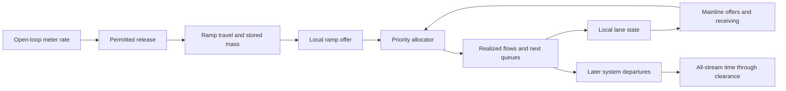

# RM9.30 — Approved allocator, control effects and next physical-law gate

Date: 2026-10-01. Status: **Historical UG2 packet; UG2.A subsequently accepted for analytic review.
New resource evidence reopens a clause of G2 at UG3; RM9 remains open.**

Read the [current findings](rm9_40_accepted_kernel_findings_and_resource_gate.md)
and [acceptance record](../discussion/rm9_handout_acceptance_and_ug2_closure.md)
for current decisions. The candidates below preserve the accepted proposal history.

## What progressed

Candidate A now has a concrete two-input merge transcription: structural
priorities share scarce receiving, and either input can use the other's unused
share when physically eligible. The [PDF](../synthesis/rm9/rm9_priority_allocator_and_control_effects.pdf)
contains the exact law, bounds, work-conservation proof, branch derivatives,
hand calculations and a proposed conservative lane-coupling alternative.
The [source readiness audit](../extraction/rm9_joint_flow_readiness_audit.md)
separates inspected equations, reviewer derivations and unapproved adaptations.

This advances the allocation subproblem. It does not establish the complete
local traffic law, exact matched aggregate histories, a useful action difference,
or a verified/useful whole-chain gradient. RM9 is not closed and no experiment
or successor review is opened.

## How service rules affect the control outcome

Consider one receiver with capacity 180 vehicle equivalents per hour and
illustrative mainline:ramp priorities of 2:1. With mainline offer 180 and ramp
offer 30, realized flows are 150 and 30. The ramp uses less than its nominal
share of 60, so the mainline receives the unused 30. If the later ramp offer
becomes 10, flows become 170 and 10: total service remains 180. Waiting moves
between streams. There is no immediate increase in total merge throughput.
The ratio and rates illustrate the algebra; they are not calibrated settings.

If both offers are below capacity, further restricting one can leave useful
capacity idle. At a multilane receiver, spare supply on an inner lane cannot
serve a shoulder/ramp queue unless a physical transfer is available. In either
case, the allocator changes the next lane/ramp state; that can affect later
storage, receiving, redistribution and final departure timing.

The objective counts ramp waiting too. Merely transferring delay from mainline
to ramp cannot improve it if the complete system departure history is unchanged.
A merge boundary need not be the final system exit; the proof concerns final
departures, including downstream and residual traffic. Congestion/spillback or
unused lane capacity are possible pathways, not effects already proved here.

## Why the next question is genuinely different

The node source supports the selected allocator. The lane-model source has
additional transfer and receiving rules. The printed special receiving branch
and the range of its combined-incentive transfer coefficient cannot be treated
as a bounded conservative interface without further conditions. A literal
interface-level algebraic diagnostic fails; this is not a proven defect in every
complete published trajectory. Silently clipping a coefficient, changing its
branch or adding a second flow operator would change traffic semantics.

The existing Roncoli 2014 predecessor does not fill the missing autonomous law:
it optimizes lateral and longitudinal flows as additional controls. Importing
those decisions would broaden the approved meter-only action. The 2015 Part I
lead has verified primary metadata, but its full methods were not retrieved in
this pass; abstract-level model admission is not an equation-level substitute.

## RM9-UG2 — which autonomous local lane-flow contract should be reviewed?

**Classification / ownership:** Type 2 review-global, user adoption; smallest
affected contract RM9-G2. RM9-E1/E2 supply transcription/proofs. RM9-G1 must be
transcribed consistently after the physical law, and G3/G4 depend on both.
RM9-UG1's Default allocator and RM9-G0's action/accounting are not reopened.

**Problem statement:** Should the first closed candidate use a deliberately
bounded discretionary lane-transfer adaptation, or should the review retain the
fuller cooperative/incentive model and first resolve its published coupling?

**Assumed model-chain function:** Lane state generates autonomous lateral
transfer offers; feasible transfers update lane occupancy. Conservative mainline
propagation and the approved merge allocator then update the ramp/mainline
system. Those updates determine observations, departures and meter sensitivities.
Lateral movement is traffic response, not an additional control variable.

**Core gap:** The selected merge node handles competition once admissible offers
and supply are known. It does not generate those offers or prove a coupled lane
update. The fuller source includes incentives and corrected demand/supply rules
that have not passed a joint conservative transcription. Restricting them or
replacing their coupling changes the modeled mechanism. Consequently an exact
history/action pair or derivative for an assumed combined law would be premature.

### Candidate A — bounded discretionary transfer with explicit conservative splitting (recommended)

Start with a two-physical-lane reference so there is no hidden within-rest mixing.
The proposed local model is lane-resolved CTM-style macroscopic propagation:
longitudinal cells indexed by i, two lane states in each cell, within-cell lateral
exchange, and forward flow from a cell to its downstream neighbor. It is not
implicitly one well-mixed compartment per lane for the entire merge region.
The local domain, cell count/length, ramp-entry location and boundary coupling
remain to be specified; no whole-freeway lane expansion is implied. A one-cell
specialization would need explicit boundaries and justification, rather than
being assumed equivalent to a longer cell chain.
Use the bounded density-attractiveness form reproduced in FB0030 equation 5
as a **discretionary propensity**, with declared structural aggressiveness and
location parameters. It is not the source's full mandatory/courtesy incentive
sum. Realize a within-cell lateral transfer subject to donor mass, receiving and
storage; update both lane masses together. Then recompute state limits from
the updated state while retaining the unspent original donor and receiver budgets.
Propagate longitudinally and apply the approved allocator
where ramp and mainline share a receiver. The PDF makes this proposed two-stage
update and its conservation/bounds concrete. Ramp release/propagation remains a
separately conserved path, not guaranteed instantaneous entry.

Use known lane-specific parameters without imposing equal speeds; keep the strong
observer and examine whether it reconstructs the contrast. No capacity-drop term
is added to force a metering advantage. Begin with ordinary finite receiving and
lane imbalance; any later acceleration/capacity-loss extension is a new contract.
This is an explicitly adapted first-order model, not a claim to reproduce the
complete FB0030 or Roncoli calibrated scheme. Approval would authorize an analytic
review of this candidate, not its production implementation or empirical validity.

**Pros:** Supplies a concrete bounded, conservative candidate without repairing
an ambiguous source branch; separates propensity from actual accepted transfer;
keeps autonomous lane response and the existing meter-only action. Two lanes
avoid lossy rest-group closure. Allows exact sufficiency or a negative result,
and exposes sensitivity branches without new stochastic/event estimators.

**Cons:** Excludes explicit courtesy, mandatory mainline lane changes and
acceleration-related capacity drop. Lateral transfers reserve part of the
original shared donor and receiver budgets before forward/ramp allocation,
giving lateral movement precedence within the proposed step. That resource and
precedence assumption is not an established physical merge/acceleration cost.
The within-cell split update is a reviewer adaptation with timestep dependence,
not a calibrated source result. It may show
aggregate sufficiency or no useful metering distinction. A positive proof would
remain conditional on this restricted family and need later validity/extension
review before becoming research-ready.

**Dependencies and scientific consequence:** Freeze the proposed local update
only after approval, then transcribe all strong observations and initial/history
support. Check exact conservation and feasible storage by mathematics. Test
identifiability and action benefit before gradient claims; do not weaken the
observer or add a lane penalty after an unfavorable answer. Priority values and
timestep remain declared parameters, with robustness conditions rather than a
numerical cost gate.

**Deferred variants (2026-10-02):** The two mainline lanes already belong to
this proposal. User-suggested merge-aware avoidance, finite short-lane/end-position
urgency and speed/acceleration-related receiving consumption are recorded as
X1–X3 in the [extension register](../synthesis/rm9/rm9_deferred_lane_interaction_extensions.md).
They are plausible extensions, not requirements or approved laws for the current
pass. Their omission narrows what A can establish about real merge behavior.
They can be reviewed individually without automatically adopting all of B.

### Candidate B — retain the fuller incentive/cooperation family; resolve source coupling first

Keep route/courtesy anticipation and the capacity-loss option as candidate
mechanisms. Continue equation-level literature/source clarification of the full
joint lane/ramp update, including coefficient ranges, zero-receiving branches,
donor sharing and modified demand/supply. Seek a published bounded autonomous
alternative if needed. Adopt a complete law only after its domain and coupling
to the Default allocator are clear; present any actual repair as an amendment.
Do not import optimized lateral flow as an extra actuator. X1–X3 are also
possible later individual extensions of A; recording them does not select B or
approve any of its fuller physical mechanisms.

**Pros:** Retains physically motivated merge cooperation and the possibility of
acceleration/capacity recovery; may provide a better basis for extension and
cross-fidelity relevance than the restricted first-order kernel. Avoids discarding
a useful full model solely because an isolated printed equation is problematic.

**Cons:** No unambiguous complete conservative law is ready from the currently
inspected sources. More source clarification may still fail or lead to a richer
state family. Published calibration alone would not prove hidden-history
necessity or useful gradients. It postpones the exact task certificate and must
not silently repair a branch or change the actuator to maintain progress.

**Dependencies and scientific consequence:** Continue source-level review under
unchanged strong observer, meter-only control and accounting. If an alternative
requires acceleration states or new capacity-loss memory, inventory that specific
contract before adoption. Source-access limitations alone do not prove the family
unavailable. The closed VSL result and historical implementation-compatible ramp
verdict remain separate.

**Provisional recommendation: A.** It offers the smallest explicit physical law
for an honest analytic sufficiency/action test. Its narrower validity is declared;
a favorable answer is not assumed. Choose B if retaining a cooperation or
capacity-recovery mechanism is essential to the first ramp task. This is a
physical-model decision, not an allocation reapproval or a runtime-cost tradeoff.

## Original stop and subsequent disposition

This packet stopped at UG2. The user subsequently accepted the handout and A,
confirmed extension deferral, and authorized continuation. That approval is
preserved in its [record](../discussion/rm9_handout_acceptance_and_ug2_closure.md).
The continued audit reached [UG3](rm9_40_accepted_kernel_findings_and_resource_gate.md)
on a newly quantified service debit. This explicitly reopens only G2's residual
resource clause; it does not undo the adoption record, change the Default node,
or start an extension. No accepted equations are edited pending that decision.
